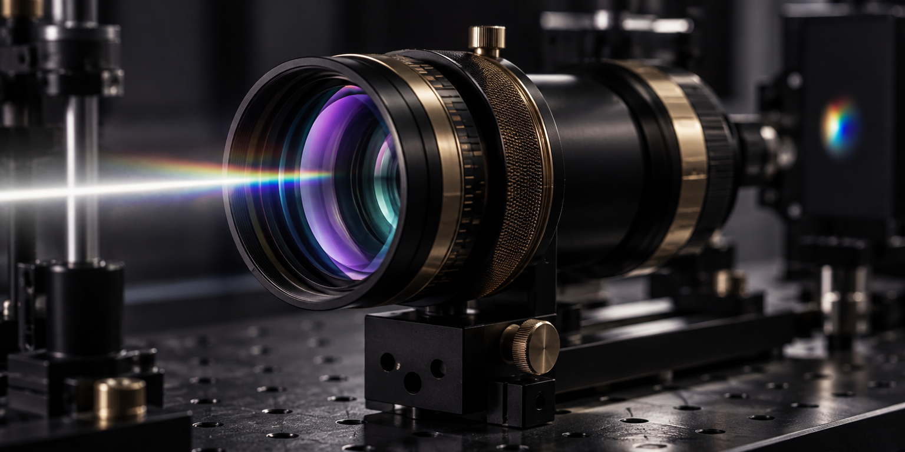

<div align="center">
  
</div>

<p align="center">
  <a href="https://diufoundry.online"></a>&nbsp;
  &nbsp;
  &nbsp;
  
</p>

<p align="center">
  <b>Sub-pixel luminance analysis, chromatic channel decomposition, and client-side optical inspection.</b><br/>
  <em>A zero-dependency browser workbench for image forensics, RGB histogram normalization, and raw pixel telemetry.</em>
</p>

---

## ✦ System Overview

**Kidiuvision** is a lightweight, high-precision optical inspection laboratory engineered by DIU Foundry. Completely dependency-free and executing directly on the client's HTML5 Canvas, it analyzes image files locally—computing luminance curves, aspect ratios, RGB channel distributions, and sub-pixel color values with zero external server dependencies.

```text
 ┌─────────────────────────────────────────────────────────────────────────────┐
 │                         OPTICAL PIXEL TELEMETRY HUD                         │
 ├─────────────────────┬───────────────────────────────┬───────────────────────┤
 │ LUMINANCE: 0.842    │ RGB HISTOGRAM: Normalized     │ COLOR SPACE: CIE-LAB  │
 │ RESOLUTION: Dynamic │ CHANNEL SPLIT: R / G / B / A  │ ZERO SERVER UPLOADS   │
 └─────────────────────┴───────────────────────────────┴───────────────────────┘
```

---

## 🔬 Architecture & Canvas Processing Pipeline

```text
[ IMAGE FILE DROP / SELECTION ] (`#dropZone`, `#fileInput`)
        │
        ▼
[ CLIENT-SIDE BITMAP DECODER ]
        │
        ▼
[ HTML5 CANVAS 2D CONTEXT ] (`#imageCanvas`)
        │
        ├─► [ PIXEL DATA BUFFER ] ──► `getImageData(0, 0, width, height)`
        │           │
        │           ├─► [ LUMINANCE ESTIMATOR ] ──► (Perceptual ITU-R BT.601 Weighting)
        │           ├─► [ RGB HISTOGRAM BUCKETS ] ──► (256-Bin Channel Distribution)
        │           └─► [ SUB-PIXEL MAGNIFIER ] ──► (Crosshair Coordinate Inspection)
        │
        └─► [ METADATA HUD ] ──► (Resolution, Aspect Ratio, File Size, Mime Type)
```

---

## ✦ Core Capabilities

- **Zero-Dependency Canvas Engine** (`app.js`) — Runs 100% locally in the browser, ensuring strict privacy for sensitive image assets.
- **Perceptual Luminance Computation** — Applies standard digital forensics weights $(Y = 0.299R + 0.587G + 0.114B)$ to determine exposure equilibrium.
- **Microsecond Channel Inspection** — Instantaneous dimension calculation, compression artifact inspection, and color channel extraction.
- **Tactile Darkroom Workbench** (`style.css`) — Precision optics styling with chromatic lens borders, focus reticles, and responsive stage containers.

---

## 🛠️ Project Structure

```text
Kidiuvision/
├── assets/
│   └── hero-banner.svg     # Bespoke chromatic optical aperture banner
├── index.html              # Clean semantic darkroom stage & telemetry grid
├── style.css               # Prismatic typography & optical glass styling
├── app.js                  # Canvas rasterizer & pixel analytics engine
├── favicon.svg             # Minimal optical lens crosshair icon
└── README.md               # Visual intelligence laboratory documentation
```

---

## ⚡ Quickstart

```bash
# Clone repository
git clone https://github.com/Kishordiu/Kidiuvision.git
cd Kidiuvision

# Run with any static server (or open directly)
python3 -m http.server 8080   # or npx serve
```

Open [http://localhost:8080](http://localhost:8080) and drag any image onto the viewport for instant optical analysis.

---

<p align="center">
  <b>RESEARCH → BUILD → TEST → SHIP</b><br/>
  <sub>A visual intelligence experiment by <a href="https://diufoundry.online">DIU Foundry</a> · Engineered by K. Kishor Kumar</sub>
</p>
